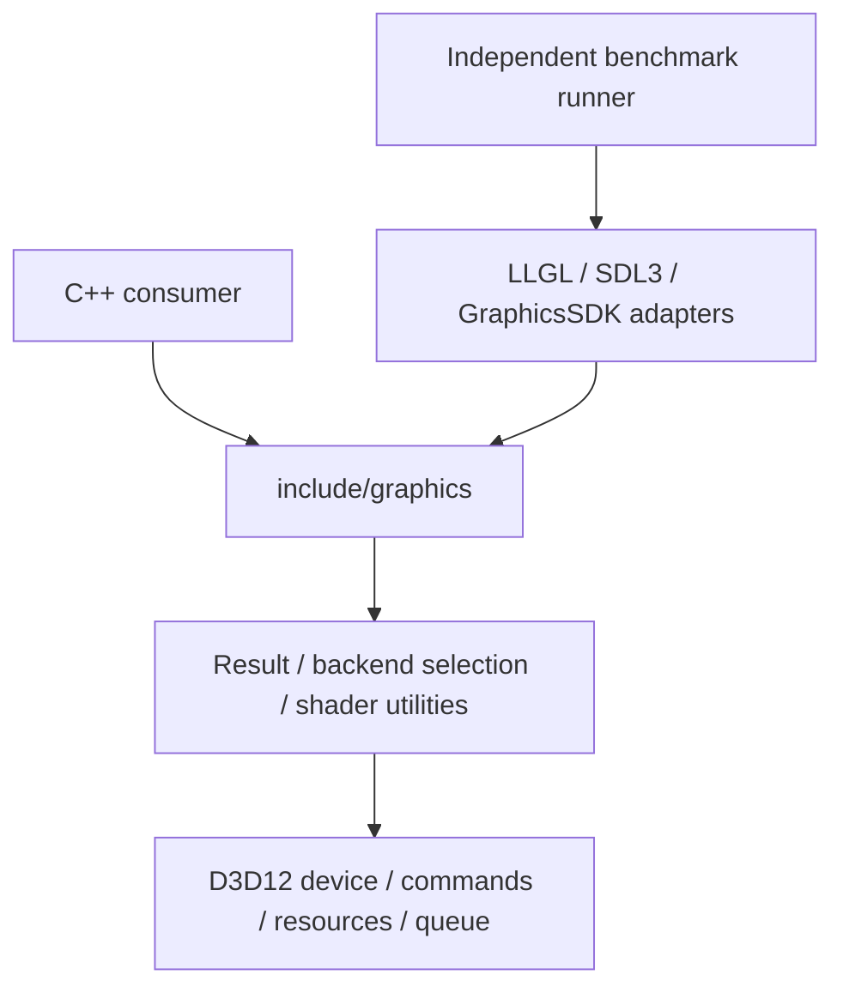

# Architecture

GraphicsSDK는 C++23 정적 라이브러리다. 공개 헤더는 표준 라이브러리만 사용하고
OS/GPU API 헤더는 구현에만 포함한다. SDK 코어는 비교 대상 SDK, Sandbox,
게임/미디어/UI 애플리케이션 또는 asset/window framework에 의존하지 않는다.

`Device`와 자원은 backend 구현을 가상 인터페이스 뒤에 숨긴다. 자원은 shared_ptr
소유권을 사용하고 명령 기록은 native 참조와 상태 snapshot을 저장한다. 제출 시
native 참조를 fence batch로 옮겨 GPU 완료까지 유지한다. batch에는 장치 shared_ptr가
없으므로 장치와 batch 간 순환 참조가 없다.

장치 세대는 native 퇴역을 위해 객체를 weak registry에 등록한다. 진단 조회는 살아 있는
wrapper/native command payload와 완료되지 않은 batch의 자원을 합쳐 중복을 제거한다.
따라서 CPU wrapper 해제와 GPU가 요구하는 native 참조의 해제를 구분해 관찰할 수 있다.
완료 batch와 만료 등록은 조회/완료 처리 때 정리한다. allocation 통계는 resource의 크기 합이며
driver cache/descriptor heap/PSO/residency는 별도 OS observer 범위다. 진단 traversal을 호출할
때만 계산하며 draw마다 집계하지 않는다. 독립 stress 도구는 SDK의 공개 API만 사용한다.

장치 조작은 생성 스레드에서 수행한다. 첫 구현은 단일 direct queue이며 병렬 기록,
다중 queue, compute, render graph는 공개 capability로 완료를 주장하지 않는다.
API는 0.0.1 초기 개발 단계로 아직 ABI/API 안정성 계약이 없다. 외부 소비자 설치 검증은
지원하지만 v0.1 전체 크로스플랫폼 출시와는 구분한다.
