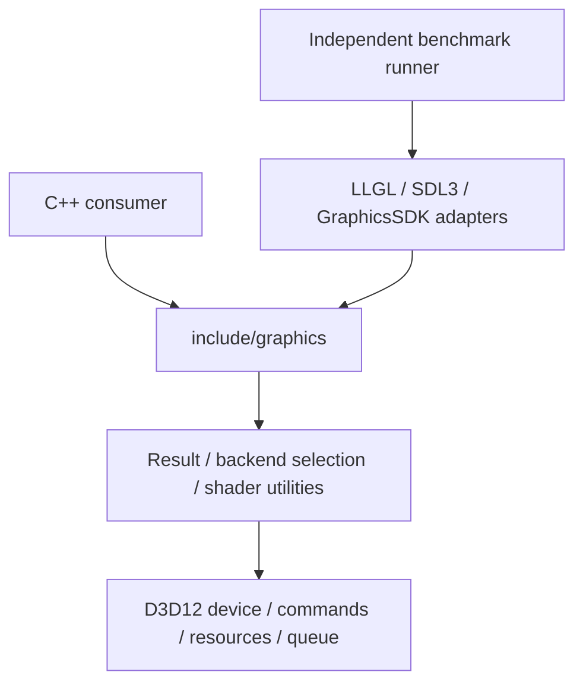

# Architecture

GraphicsSDK는 C++23 정적 라이브러리다. 공개 헤더는 표준 라이브러리만 사용하고
OS/GPU API 헤더는 구현에만 포함한다. SDK 코어는 비교 대상 SDK, Sandbox,
게임/미디어/UI 애플리케이션 또는 asset/window framework에 의존하지 않는다.

`Device`와 자원은 backend 구현을 가상 인터페이스 뒤에 숨긴다. 자원은 shared_ptr
소유권을 사용하고 명령 기록은 native 참조와 상태 snapshot을 저장한다. 제출 시
native 참조를 fence batch로 옮겨 GPU 완료까지 유지한다. batch에는 장치 shared_ptr가
없으므로 장치와 batch 간 순환 참조가 없다.

장치 세대는 native 퇴역을 위해 객체를 weak registry에 등록한다. 진단 조회는 살아 있는
wrapper/native command payload와 완료되지 않은 batch의 자원을 합쳐 중복을 제거한다.
따라서 CPU wrapper 해제와 GPU가 요구하는 native 참조의 해제를 구분해 관찰할 수 있다.
완료 batch와 만료 등록은 조회/완료 처리 때 정리한다. allocation 통계는 resource의 크기 합이며
driver cache/descriptor heap/PSO/residency는 별도 OS observer 범위다. 진단 traversal을 호출할
때만 계산하며 draw마다 집계하지 않는다. 독립 stress 도구는 SDK의 공개 API만 사용한다.

장치 조작은 생성 스레드에서 수행한다. 첫 구현은 단일 direct queue이며 병렬 기록,
다중 queue, compute, render graph는 공개 capability로 완료를 주장하지 않는다.
API는 0.0.1 초기 개발 단계로 아직 ABI/API 안정성 계약이 없다. 외부 소비자 설치 검증은
지원하지만 v0.1 전체 크로스플랫폼 출시와는 구분한다.

D3D12의 private `FenceWaiter`는 양수 대기의 이벤트를 generation별로 재사용한다.
미완료 등록의 기준은 단일 증가 fence의 다음 미완료 값이며 timeout 뒤에도 같은 등록을
유지한다. 완료/지연 신호를 다시 확인하고 원래 deadline을 유지하므로 더 이른 목표의 재시도나
오래된 이벤트 wake를 잘못 완료로 처리하지 않는다. 0ms 조회는 이벤트를 만들거나 등록하지
않는다. 퇴역은 fence native 참조 해제 뒤 이벤트를 닫는다. 기존 안전 종료의 GPU drain과
resource batch 소유권은 유지한다. private backend header도 CMake/Python source fingerprint에
포함하며 설치 public header에 Win32 타입을 추가하지 않는다.

백버퍼 tracker는 swapchain별 약한 scope와 buffer index를 가진다. 명시적인 texture
입력과 submit은 scope 생존 및 native current index를 확인한다. 공개 swapchain 파괴/퇴역은
scope를 무효화하며, 이 scope는 public wrapper를 강하게 보유하지 않는다. 성공한 present는
해당 tracker version을 증가시켜 한 바퀴 회전 뒤에도 오래된 기록을 거부한다. 일반 texture/
buffer에는 native index 조회를 추가하지 않으며 SDK의 단일 생성 thread 계약을 유지한다.

어댑터 열거는 장치를 만들지 않는 backend dispatch이며 독립 factory의 CPU 메타데이터 snapshot을
반환한다. backend-scoped opaque ID를 DeviceDesc에 지정하면 D3D12는 EnumAdapterByLuid로
정확히 선택하고 native Device의 실제 LUID를 다시 확인한다. 같은 descriptor를 복구에 보존해
재시도 동안 선택이 바뀌지 않는다. 기본 descriptor는 기존 OS 선호 정책을 유지한다.
Topology 변화에 따른 영속 ID·자동 GPU 대체 정책은 제공하지 않는다.

`queryMemoryBudget`는 creating thread의 건강한 native device LUID로 adapter를 찾고 node 0의
local/nonlocal OS process budget을 각각 조회한다. SDK allocation traversal이나 fence 완료
정리를 호출하지 않는다. 같은 process/adapter의 다른 native owner 비용을 포함할 수 있는
동적 관측이므로 SDK 보유 통계·정적 adapter capacity와 구분한다. 반환은 네 native byte 필드를
변형하지 않으며 미지원/오류를 0으로 바꾸지 않는다. 손실·퇴역은 기존 상태 guard로 native
참조 접근 전에 거부하고 복구 뒤에는 새 generation의 같은 ID에서 다시 조회한다.
