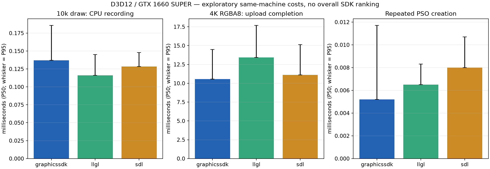

# Benchmark report

측정일: 2026-10-20 (Asia/Seoul). 실제 원자료에서 tools/report_benchmarks.py로 생성.

## 측정 환경

- CPU: Intel(R) Core(TM) i7-14700K; RAM: 68473667584 bytes.
- GPU: NVIDIA GeForce GTX 1660 SUPER; LUID `0:95937`; driver `32.0.16.1088`; software=False.
- OS: Windows 10.0.26220; compiler: MSVC 194435228; Release /O2, /MD, x64, no LTO.
- D3D12, validation off, single CPU thread, one frame in flight, headless, VSync 비해당.
- LLGL `649c0cc8fa608312c5e4b94dae409a5859fc7553`; SDL `3b2bc951500ca6a1f428af77e036e732d9a8afe3`.
- GraphicsSDK는 각 원자료의 sdk_build_source_sha256로 식별한다. 실행 파일 SHA도 보존한다.
- Desktop 공유 환경이다. 별도 빌드와 GPU 테스트는 이 캠페인 도중 실행하지 않았다. 사용자/OS background 부하는 통제하지 않았다.

## 범위와 측정 경계

각 workload는 3개 독립 프로세스 회차다. draw 10k는 회차당 warmup 30/표본 240, 다른 draw/instancing은 20/120, upload/PSO는 10/120, allocation은 5/30이다.
Allocation은 시간이 긴 작업이어서 30표본으로 줄였다. 회차간 변동이 커 P99는 탐색 지표다. 원자료와 회차별 median/MAD는 JSON/CSV에 있다.
Draw: 동일 DXBC, 64×64 RGBA8, triangle 3 vertices, no depth/blend/cull, one clear, 같은 draw/instance 수. 100k draw는 인위적 stress로 실사용 성능을 대표하지 않는다.
Upload: 이미 준비한 CPU payload에서 pre-existing texture의 GPU copy 완료까지. 1920×1080/3840×2160 RGBA8 및 3840×2160 RGBA16F. 행은 256-byte 정렬, source memcpy와 내부 staging 비용 포함. setup/readback은 측정 밖이다.
PSO: 미리 compile한 shader로 반복 생성/해제. SDK 내부 caching 허용, driver cache는 통제하지 않았으며 cold compilation/cache hit-miss로 부르지 않는다. core는 root signature 생성도 포함한다.
Allocation: default GPU buffers 64KiB ×1000, sampled textures 64×64 RGBA8 ×1000, uninitialized, create/release/idle. 실제 물리 allocation 수나 GPU 메모리 peak를 의미하지 않는다.
모두 end-to-end 범주다. LLGL End와 SDL Submit의 내부 경계가 다르므로 record와 submit 구간만으로 저수준 API 우위를 주장하지 않는다. GPU 시간은 공통 suite에서 null이며 CPU wait를 GPU 시간으로 대체하지 않았다.
이미지/업로드 시나리오는 측정 전후 readback을 통과했다. 별도 GraphicsSDK correctness 테스트에서 실제 GPU timestamp를 확인했다.

## Draw와 Instancing

단위 ms. Frame은 record+submit+완료 대기 wall time이다.

| Scenario | Count | SDK | Record P50 | Submit P50 | Frame P50 | Frame P95 | Frame P99 |
|---|---:|---|---:|---:|---:|---:|---:|
| draw | 1000 | graphicssdk | 0.024700 | 0.019650 | 0.127100 | 0.335740 | 0.996700 |
| draw | 1000 | llgl | 0.028250 | 0.031050 | 0.145900 | 0.338815 | 0.882017 |
| draw | 1000 | sdl | 0.018900 | 0.022900 | 0.124850 | 0.271375 | 0.900628 |
| draw | 10000 | graphicssdk | 0.137100 | 0.027200 | 0.507350 | 1.080500 | 1.565251 |
| draw | 10000 | llgl | 0.115950 | 0.033450 | 0.485550 | 0.863690 | 1.606545 |
| draw | 10000 | sdl | 0.128400 | 0.029750 | 0.471550 | 0.997005 | 1.534781 |
| draw | 100000 | graphicssdk | 1.529350 | 0.173650 | 4.881000 | 6.380695 | 6.692086 |
| draw | 100000 | llgl | 1.338150 | 0.177950 | 4.775650 | 6.468645 | 7.135354 |
| draw | 100000 | sdl | 1.561850 | 0.203750 | 4.950750 | 6.412390 | 7.049817 |
| instanced | 1000 | graphicssdk | 0.013600 | 0.020050 | 0.110800 | 0.172565 | 0.757705 |
| instanced | 1000 | llgl | 0.020250 | 0.036700 | 0.138300 | 0.314015 | 0.844428 |
| instanced | 1000 | sdl | 0.003900 | 0.021000 | 0.101900 | 0.196030 | 0.814539 |
| instanced | 10000 | graphicssdk | 0.031100 | 0.038200 | 0.477250 | 1.087215 | 1.447071 |
| instanced | 10000 | llgl | 0.041150 | 0.062350 | 0.516750 | 1.070590 | 1.441451 |
| instanced | 10000 | sdl | 0.012200 | 0.051950 | 0.485000 | 1.078120 | 1.425539 |
| instanced | 100000 | graphicssdk | 0.123500 | 0.098300 | 3.058150 | 4.620475 | 4.841664 |
| instanced | 100000 | llgl | 0.128900 | 0.139250 | 3.079150 | 4.597630 | 5.165345 |
| instanced | 100000 | sdl | 0.040600 | 0.123300 | 3.056200 | 4.620910 | 4.929914 |

## Texture upload

GB/s는 decimal payload bytes / P50 latency의 파생 유효 처리량이며 PCIe counter가 아니다.

| Scenario | SDK | Latency P50 ms | P95 ms | P99 ms | Effective GB/s |
|---|---|---:|---:|---:|---:|
| upload1080 | graphicssdk | 1.882050 | 4.031660 | 5.547462 | 4.407 |
| upload1080 | llgl | 3.745100 | 6.076495 | 6.734012 | 2.215 |
| upload1080 | sdl | 1.937650 | 3.735445 | 4.514464 | 4.281 |
| upload4k | graphicssdk | 10.552150 | 14.495510 | 15.887893 | 3.144 |
| upload4k | llgl | 13.422850 | 17.672900 | 19.721636 | 2.472 |
| upload4k | sdl | 11.106250 | 15.122750 | 16.563129 | 2.987 |
| upload4k16f | graphicssdk | 21.042700 | 33.800145 | 37.698422 | 3.153 |
| upload4k16f | llgl | 26.904600 | 43.699815 | 48.174422 | 2.466 |
| upload4k16f | sdl | 20.660900 | 35.613575 | 40.911143 | 3.212 |

## Allocation 및 Pipeline

단위 ms. Release API는 실제 회수 비용과 다를 수 있어 전체 batch 비용을 함께 본다.

| Scenario | SDK | Create P50 | Release API P50 | Frame P50 | Frame P95 | Frame P99 |
|---|---|---:|---:|---:|---:|---:|
| buffers | graphicssdk | 364.550550 | 197.529500 | 562.622200 | 767.518580 | 807.152619 |
| buffers | llgl | 363.118500 | 199.322350 | 558.632550 | 663.181985 | 716.616494 |
| buffers | sdl | 381.573650 | 0.151250 | 618.935150 | 828.181940 | 889.019994 |
| pipeline | graphicssdk | 0.005200 | 0.000400 | 0.005700 | 0.012800 | 0.021845 |
| pipeline | llgl | 0.006500 | 0.000500 | 0.007200 | 0.009105 | 0.010851 |
| pipeline | sdl | 0.008000 | 0.000100 | 0.008200 | 0.010900 | 0.017651 |
| textures | graphicssdk | 384.179250 | 153.879000 | 538.529800 | 703.125790 | 755.994525 |
| textures | llgl | 374.610500 | 158.339250 | 542.515450 | 665.810970 | 780.235515 |
| textures | sdl | 382.958900 | 0.692150 | 535.357150 | 706.113205 | 776.959919 |

## 그래프

## 확인된 개선과 해석

- OPT-001 draw 10k record_ms: P50 3.328900 → 0.137100 ms (-95.88%). 이전 회차 median=[3.10785, 3.9414, 3.2600499999999997]; 이후=[0.1248, 0.1502, 0.13590000000000002].
- OPT-001 draw 10k frame_ms: P50 3.909050 → 0.507350 ms (-87.02%). 이전 회차 median=[3.5232, 4.76755, 3.7827]; 이후=[0.5229, 0.51325, 0.4699].
- 매 draw의 GetDeviceRemovedReason 호출을 begin/submit/wait 경계 검사로 옮겼다. 수명/상태/스레드 검증은 유지했고 전체 GPU correctness 및 validation을 재실행했다.
- Draw 10k 공통 비교에서 GraphicsSDK frame P50은 LLGL/SDL과 가까운 범위지만 꼬리와 회차 변동이 있어 성능 우위를 확정하지 않는다.
- 낮게 관측된 항목: 4K RGBA8 upload P50은 GraphicsSDK 10.552150 ms, LLGL 13.422850 ms, SDL 11.106250 ms다. 회차별 변동과 P95 범위가 겹치므로 보편적 우위나 통계적 유의성으로 해석하지 않는다.
- 뒤처진 항목: draw 10k record P50은 GraphicsSDK 0.137100 ms, LLGL 0.115950 ms, SDL 0.128400 ms다. PSO create도 표의 SDK별 차이를 별도로 평가해야 한다. 아직 cache/driver profiler로 원인을 확정하지 않았다.
- 반복 PSO 생성은 core의 root signature 재생성 비용과 SDK 캐시 정책을 포함한다. 큰 차이가 관측되면 cache hit를 통제한 D 확장 및 profiler로 원인을 확인한다.
- LLGL/SDL의 allocation/release 위치가 달라 API release 시간만의 순위는 무의미하다. upload는 staging 재사용 정책에 따른 차이를 포함한다.

## 개선 우선순위

1. PSO/root signature 재사용 및 cold/warm/cache-hit 조건 분리 측정.
2. committed allocation 병목에 대해 memory budget/peak와 실제 native allocation을 계측한 뒤 allocator/pooling 검토.
3. 다중 texture/upload frame slots와 범용 binding의 정확성부터 확장.
4. 공통 GPU timestamp/프로파일러 캡처와 bgfx/Diligent/Forge adapters 확장 후 Vulkan으로 진행.

## 미검증 및 제외한 자료

- `2026-10-20-competitors-c`는 빌드 작업과 겹친 최초 탐색 측정이다. 원자료는 보존하되 위 표와 성능 목표 기준에서 제외했다.
- Shader cold/warm compiler cache, controlled PSO cache hit/miss, E/F/G/H, multi-texture/reuse/in-flight allocation, CPU utilization, peak GPU/CPU memory, build-time comparison은 미측정이다.
- PIX/RenderDoc/Nsight/Tracy capture, Linux/Vulkan/macOS/Metal과 실제 game/video/UI는 미검증이다.
- CPU-only allocation과 실 GPU rendering을 섞어 전체 순위를 만들지 않는다. WARP 결과는 기능 테스트에만 사용한다.

## 원자료

- [2026-10-20-draw-1000 JSON](../benchmarks/results/2026-10-20-draw-1000/summary.json), [CSV](../benchmarks/results/2026-10-20-draw-1000/summary.csv).
- [2026-10-20-draw-after JSON](../benchmarks/results/2026-10-20-draw-after/summary.json), [CSV](../benchmarks/results/2026-10-20-draw-after/summary.csv).
- [2026-10-20-draw-100000 JSON](../benchmarks/results/2026-10-20-draw-100000/summary.json), [CSV](../benchmarks/results/2026-10-20-draw-100000/summary.csv).
- [2026-10-20-instanced-10000 JSON](../benchmarks/results/2026-10-20-instanced-10000/summary.json), [CSV](../benchmarks/results/2026-10-20-instanced-10000/summary.csv).
- [2026-10-20-upload-pipeline JSON](../benchmarks/results/2026-10-20-upload-pipeline/summary.json), [CSV](../benchmarks/results/2026-10-20-upload-pipeline/summary.csv).
- [2026-10-20-pipeline-final JSON](../benchmarks/results/2026-10-20-pipeline-final/summary.json), [CSV](../benchmarks/results/2026-10-20-pipeline-final/summary.csv).
- [2026-10-20-allocation-quiet JSON](../benchmarks/results/2026-10-20-allocation-quiet/summary.json), [CSV](../benchmarks/results/2026-10-20-allocation-quiet/summary.csv).
- [OPT-001 전후 비교](../benchmarks/reports/2026-10-20-opt-001/comparison.md). 비용 변화율 = 100*(after_p50/before_p50-1).
- [실제 측정 build의 SDK source snapshots](../benchmarks/reports/sources/README.md). Archive 이름의 SHA는 원자료 build fingerprint와 일치한다.

The [Vulkan upload baseline](PHASE3_VULKAN_UPLOAD_REPORT.md) is a separate API/category
comparison on the unchanged installed SDK and pinned SDL3. Its six device/workload
rows, raw samples and correctness evidence are not combined with these D3D12 results.
No overall SDK ranking or profiling diagnosis is inferred.

The [first same-Vulkan draw/instancing measurements](PHASE3_VULKAN_DRAW_BENCHMARK_REPORT.md)
are now available for GraphicsSDK and pinned SDL on NVIDIA/Intel. All six measured
cells have longer GraphicsSDK P50 wall time; this small scissored workload does
not establish an overall SDK ranking. See the report for primary and CPU stage
statistics, full-image verification, initial shader compatibility failures and
reproduction evidence. D3D12, upload and rejected memory-candidate results are
kept in their own contracts and are not pooled with this draw profile.
